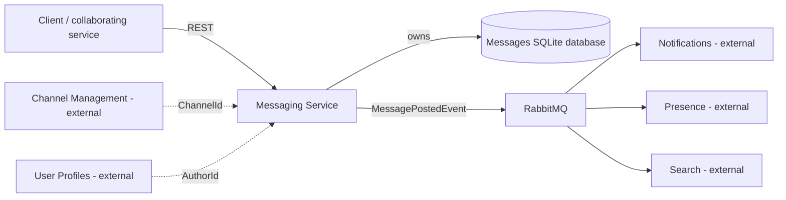
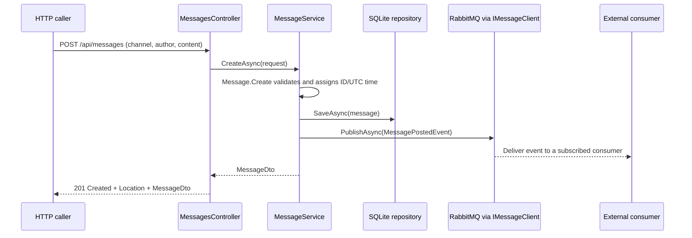

# Bizcord: analysis and design

## Context and selected responsibility

Bizcord is a Discord-like, real-time enterprise communication platform. The course project implements its backend. This repository develops **one bounded context: Messaging**. Week 40's provider track is the first feature: a user posts a message, the service persists it and announces the fact to other services.

## Domains, boundaries, and data ownership

| Bounded context | Responsibility | Data it owns | Relationship to Messaging |
| --- | --- | --- | --- |
| Messaging (implemented here) | Store, retrieve, edit, and delete messages | Message ID, channel/author references, content, posting time | Publishes `MessagePostedEvent`; exposes message DTOs over REST |
| Channel Management | Channel lifecycle and membership rules | Channels, descriptions, memberships | Provides the identity of the channel containing a message |
| User Profiles / Identity | User identity and public profile | Users, display names, identity information | Provides the identity of the message author |
| Notifications | Notify users about activity/mentions | Notification state and delivery preferences | Can consume `MessagePostedEvent` |
| Presence | Track recent user activity | Last-active times and presence | Can consume `MessagePostedEvent` |
| Search | Find messages by content | A derived search index | Can consume `MessagePostedEvent` |

These are separate responsibilities even where they refer to the same user or channel. Messaging keeps only their IDs. It does not copy user profiles, channel membership rules, notification preferences, or search indexes into its own model. Each context owns its storage; another service must use a public contract rather than reading the messages database.

The related concepts differ by context: Messaging needs an author's identity; Notifications needs delivery preferences; Presence needs an activity timestamp. Those internal models do not have to be shared.

## Context map

The dashed references describe ownership, not implemented HTTP calls. Only Messaging and its broker are deployed by this repository. Real-time delivery to clients can be built by another consumer; this service's current output is the event.

## Internal domain model

**Message** is an entity and aggregate root with a generated GUID and a lifecycle: create, read, edit content, delete. Its channel, author, ID, and posting timestamp stay fixed after creation. Creation requires nonempty channel and author IDs.

**MessageContent** is an immutable value object with value equality and no identity. It contains 1–2,000 characters and must contain non-whitespace text. The domain enforces this independently of HTTP and database code. The maximum is a simple explicit design choice for this version, not a claimed Moodle requirement.

**MessagePostedEvent** describes the completed posting action using exactly the fields required in Week 40: `MessageId`, `ChannelId`, `AuthorId`, `Content`, and `PostedAt` (`DateTime`, UTC). The public namespace is `Bizcord.Shared.Contracts.Events`. .NET consumers should reference the shared contract project/package so EasyNetQ agrees on the message type as well as the JSON shape.

**MessageDto** is a public data contract. It contains the useful integration fields as plain values. It exposes neither the `MessageContent` implementation nor repository/database details. API requests are separate contracts from internal entities.

## Architecture

| Layer | Files | Dependency/purpose |
| --- | --- | --- |
| Presentation | `Controllers/MessagesController.cs` | HTTP routing/status codes; delegates work to the application service |
| Application | `Application/MessageService.cs` | Coordinates domain rules, persistence, DTO mapping, and publication |
| Domain | `Domain/Message.cs`, `MessageContent.cs` | Technology-agnostic model and validation |
| Infrastructure | `Infrastructure/SqliteMessageRepository.cs` | Implements the repository interface using parameterized SQL |
| Shared infrastructure | `packages/MessageClient/src` | `IMessageClient` plus an EasyNetQ/RabbitMQ adapter and DI registration |
| Shared contracts | `packages/Shared.Contracts` | Public requests, DTOs, and event types |

Folders keep the application small. The domain source has no HTTP, SQLite, or EasyNetQ dependencies. Controllers receive `MessageService` through DI; the application receives `IMessageRepository` and `IMessageClient`. A different broker would require a new adapter and registration rather than changes to domain/controller code. A different database would require a repository implementation.

SQLite is sufficient for this service's small standalone workload and requires no extra database server. Each operation opens a connection; connection pooling is managed by the provider. SQL values use parameters. The database has a primary key on message ID and an index on channel ID.

## Posting interaction

RabbitMQ acceptance does not mean every consumer has finished. Consumers process independently, so their derived data can be eventually consistent. Each independent consumer uses a distinct subscription ID; instances sharing an ID compete for deliveries.

The application is a provider for this assignment track. The message client also implements subscription, demonstrated by the real broker contract test; no extra production microservice is needed to perform that check.

## REST and error behaviour

POST creates and publishes. GET reads one/all messages, with an optional channel filter. PUT edits content while preserving identity/references/time. DELETE removes the selected message. Missing messages return `404`, invalid input returns `400`, and deletion succeeds with `204`. Errors use HTTP problem details. The first feature requires a posting event; this version does not define separate edit/delete events.

## Deployment and tradeoffs

Compose starts RabbitMQ and Messaging on its internal network. RabbitMQ has a port-connectivity health check; Messaging depends on the healthy condition and uses `RABBITMQ_HOST=rabbitmq`. The Dockerfile uses an SDK build stage, an ASP.NET runtime stage, and a non-root runtime user. Source references keep their monorepo-relative paths. A named volume preserves `/app/data`.

The supplied development credentials and host ports are restricted to localhost. `/health` reports application liveness. Compose's RabbitMQ health check handles initial broker readiness; the application liveness endpoint does not claim continued broker availability.

There is a consistency gap between saving a message and publishing its event. A broker failure produces `503`, includes the saved message ID, and explains that storage succeeded. It does not silently report successful publication. Exactly-once processing, an outbox/retry worker, authentication/authorization, external user/channel validation, migrations, pagination, and broader production reliability are outside this first version.
