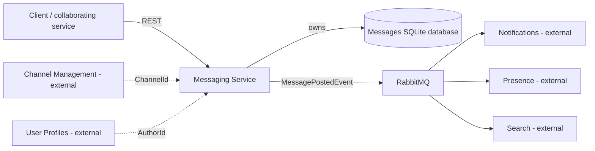
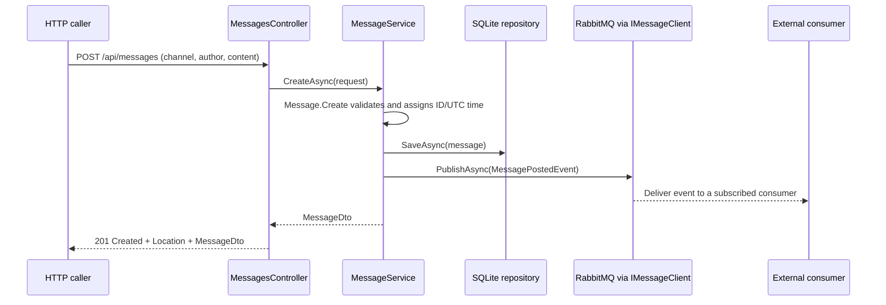

# Bizcord: analysis and design

## Context

Bizcord is a Discord-like communication platform. Messaging is the bounded context implemented in this repository. It manages channel messages and publishes an event when a message is posted, allowing other services to react independently.

## Domains, boundaries, and data ownership

| Bounded context | Responsibility | Data it owns | Relationship to Messaging |
| --- | --- | --- | --- |
| Messaging | Store, retrieve, edit, and delete messages | Message ID, channel/author references, content, posting time | Publishes `MessagePostedEvent`; exposes message DTOs over REST |
| Channel Management | Channel lifecycle and membership rules | Channels, descriptions, memberships | Provides the identity of the channel containing a message |
| User Profiles / Identity | User identity and public profile | Users, display names, identity information | Provides the identity of the message author |
| Notifications | Notify users about activity/mentions | Notification state and delivery preferences | Can consume `MessagePostedEvent` |
| Presence | Track recent user activity | Last-active times and presence | Can consume `MessagePostedEvent` |
| Search | Find messages by content | A derived search index | Can consume `MessagePostedEvent` |

Each context owns its storage and exposes data through public contracts. Messaging stores references to authors and channels as IDs. User profiles, channel membership rules, notification preferences, and search indexes belong to their respective services.

The same user can have different representations across contexts: an author ID in Messaging, delivery preferences in Notifications, and an activity timestamp in Presence.

## Context map

The dashed connections represent identity references. This deployment includes Messaging and RabbitMQ. Other services can consume the published event, including a service responsible for real-time client delivery.

## Internal domain model

**Message** is an entity and aggregate root with a generated GUID and a lifecycle: create, read, edit content, delete. Its channel, author, ID, and posting timestamp stay fixed after creation. Creation requires nonempty channel and author IDs.

**MessageContent** is an immutable value object with value equality and no identity. It contains 1–2,000 characters and must contain non-whitespace text. The domain enforces these rules independently of HTTP and database code.

**MessagePostedEvent** contains `MessageId`, `ChannelId`, `AuthorId`, `Content`, and `PostedAt` (`DateTime`, UTC). Its namespace is `Bizcord.Shared.Contracts.Events`. .NET consumers reference the shared contract project or package so that EasyNetQ uses a consistent message type and JSON shape.

**MessageDto** exposes message data as plain values. The internal value object and persistence details remain private. API requests have separate contracts from domain entities.

## Architecture

| Layer | Files | Dependency/purpose |
| --- | --- | --- |
| Presentation | `Controllers/MessagesController.cs` | HTTP routing/status codes; delegates work to the application service |
| Application | `Application/MessageService.cs` | Coordinates domain rules, persistence, DTO mapping, and publication |
| Domain | `Domain/Message.cs`, `MessageContent.cs` | Technology-agnostic model and validation |
| Infrastructure | `Infrastructure/SqliteMessageRepository.cs` | Implements the repository interface using parameterized SQL |
| Shared infrastructure | `packages/MessageClient/src` | `IMessageClient` plus an EasyNetQ/RabbitMQ adapter and DI registration |
| Shared contracts | `packages/Shared.Contracts` | Public requests, DTOs, and event types |

The domain source has no HTTP, SQLite, or EasyNetQ dependencies. Controllers receive `MessageService` through dependency injection; the application receives `IMessageRepository` and `IMessageClient`. These interfaces allow the database and broker implementations to be replaced independently of the domain and controllers.

SQLite provides persistent storage without a separate database server. Each repository operation opens a connection, with pooling managed by the provider. Queries use parameters. The database has a primary key on message ID and an index on channel ID.

## Posting interaction

RabbitMQ acceptance does not mean every consumer has finished. Consumers process independently, so their derived data can be eventually consistent. Each independent consumer uses a distinct subscription ID; instances sharing an ID compete for deliveries.

Messaging publishes posting events. The message client also supports subscriptions, which are exercised by the RabbitMQ integration test.

## REST and error behaviour

POST creates a message and publishes its event. GET reads one or all messages, with an optional channel filter. PUT edits content while preserving identity, references, and posting time. DELETE removes the selected message. Missing messages return `404`, invalid input returns `400`, and deletion succeeds with `204`. Errors use HTTP problem details. Editing and deletion do not publish events.

## Deployment and tradeoffs

Compose starts RabbitMQ and Messaging on its internal network. RabbitMQ has a port-connectivity health check; Messaging depends on the healthy condition and uses `RABBITMQ_HOST=rabbitmq`. The Dockerfile uses an SDK build stage, an ASP.NET runtime stage, and a non-root runtime user. Source references keep their monorepo-relative paths. A named volume preserves `/app/data`.

Host ports are bound to IPv4 loopback, and the included credentials are for local development. `/health` reports application liveness. RabbitMQ's Compose health check controls startup ordering; ongoing broker connectivity is not part of the application liveness check.

Saving a message and publishing its event are separate operations. A broker failure after storage produces `503` with the saved message ID and `persisted: true`. The caller can retrieve the message, but publication is not retried automatically. An outbox would be needed to close this consistency gap. Authentication, authorization, external user/channel validation, schema migrations, and pagination are not implemented.
